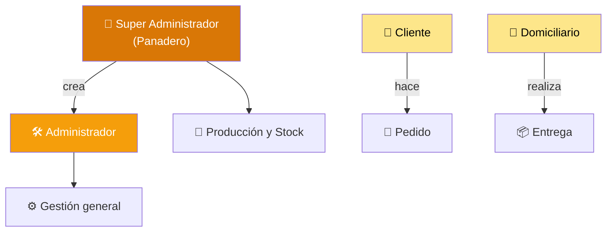
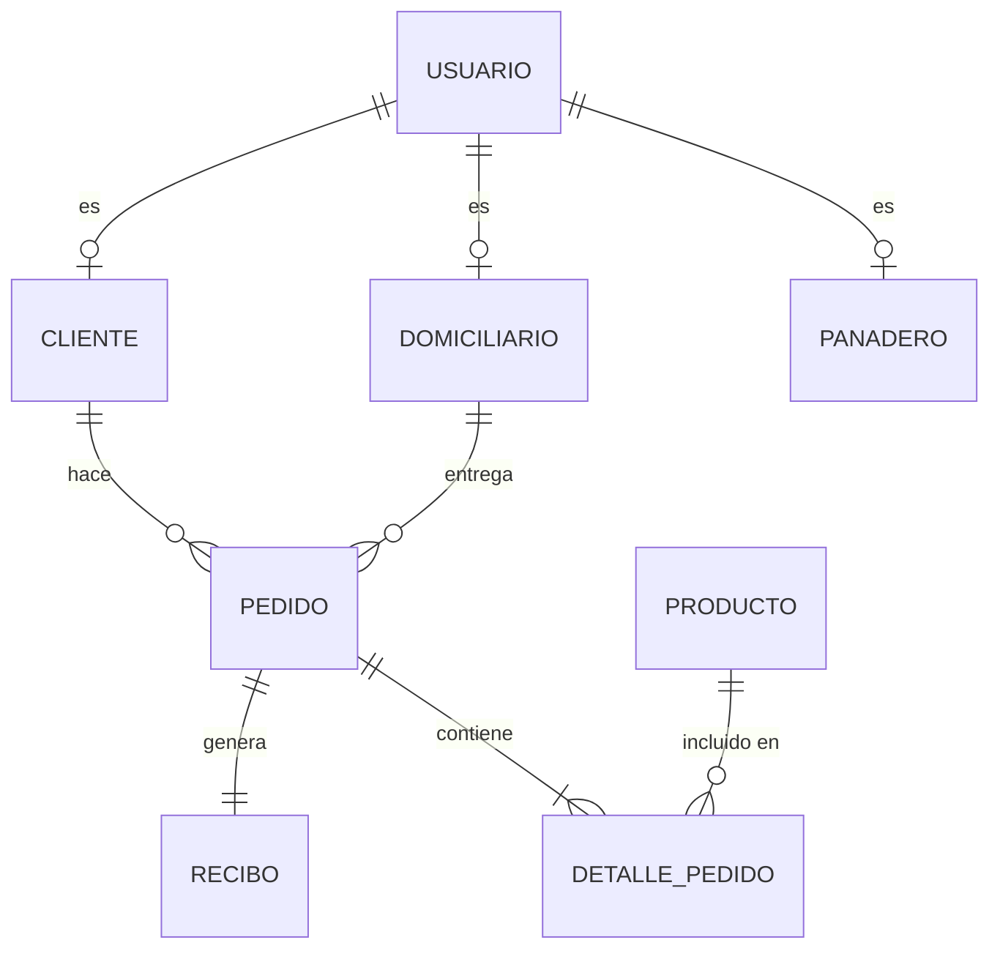
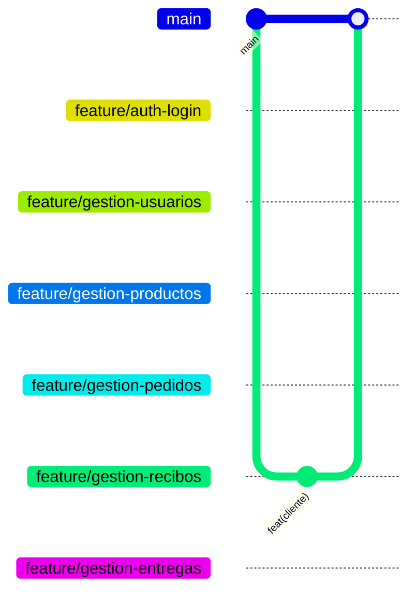

 

---

## ¿Qué es Panify?

**Panify** es un sistema web de gestión operativa y logística para **Distribuciones Oro Pan**, una **fábrica de pan** (no una panadería de pasteles) que hoy registra sus pedidos por llamadas y en papel. Ese proceso manual genera pérdida de información, retrasos en producción, confusión en las entregas y falta de comprobantes claros para los clientes.

> 💡 **Pregunta del proyecto:** ¿Cómo mejorar la recepción, organización y gestión de pedidos e inventario en Oro Pan?

Panify centraliza y digitaliza ese flujo para eliminar el registro manual, optimizar los tiempos de producción y entrega, y garantizar la trazabilidad de los productos.

> ⚠️ **Alcance:** el sistema es netamente operativo (pedidos y stock). No abarca procesos contables ni financieros externos complejos.

---

## 🧱 Módulos del Sistema

|     | Módulo                       | Descripción                                                                                                   | Responsable                     |
| :-: | :--------------------------- | :------------------------------------------------------------------------------------------------------------ | :------------------------------ |
| 🔐  | **Autenticación y Usuarios** | Login, control de acceso por rol, registro, recuperación de contraseña y perfil con historial                 | Kevin Julián González Chavez    |
| 🥐  | **Productos e Inventario**   | CRUD del catálogo, stock mínimo, alerta de producto agotado y actualización automática al confirmar un pedido | Martin Cruz Muñoz               |
| 🛒  | **Pedidos**                  | Creación de órdenes validadas contra el stock y bloqueo horario para pedidos del mismo día                    | Brayan Sneyder Devia Muñoz      |
| 🧾  | **Recibos**                  | Comprobantes en PDF y reportes operativos (diarios, semanales de lunes a domingo y mensuales)                 | Brandon Duvan Guevara Rodríguez |
| 🚴  | **Entregas y Rutas**         | Panel de prioridades por hora y urgencia, con lista de rutas simplificada                                     | Jeison Alejandro Diaz Acosta    |

---

## 👤 Roles y Permisos

- 👑 **Super Administrador (Panadero):** control total y puede crear administradores.
- 🛠️ **Administrador:** mismos permisos que el Super Administrador, pero no puede manipular a otros administradores ni darse más poder. Es un rol distinto del Panadero y del Domiciliario.
- 🙋 **Cliente:** único actor que origina "Hacer Pedido".
- 🚴 **Domiciliario:** único vinculado a "Entregar Pedido" (se desplaza en bicicleta).

---

## 🗄️ Modelo de Datos

Modelo normalizado hasta la **3FN** en MySQL Workbench (13 tablas), con jerarquía de especialización (triángulo ISA) para el control de acceso.

> 🔎 **Detalle:** `DETALLE_PEDIDO` congela el `precioFijo` histórico al comprar. El diagrama es un resumen; el modelo completo está en [`/docs/03-arquitectura-y-bd/`](./docs/03-arquitectura-y-bd/).

---

## 🛠️ Stack Tecnológico

**Frontend**

**Datos y diseño**

**Control de versiones**

---

## 🔗 Ecosistema de Repositorios

El proyecto está desacoplado en tres repositorios dentro de la organización **Panify-HQ**:

| Repositorio                                                              | Contenido                                            |      Estado      |
| :----------------------------------------------------------------------- | :--------------------------------------------------- | :--------------: |
| 🎨 [**`Panify-Frontend`**](https://github.com/Panify-HQ/Panify-Frontend) | Aplicación web cliente en React + Vite               | 🟡 En desarrollo |
| ⚙️ [**`Panify-Backend`**](https://github.com/Panify-HQ/Panify-Backend)   | API REST (documentación en curso, stack por definir) | 🟠 En planeación |
| 📄 **`Panify-Documentacion`** _(este repositorio)_                       | Análisis, UML, modelo de BD, costos y sustentaciones |    🟢 Activo     |

---

## 🎯 Matriz de Entregables Trimestrales

El proyecto formativo consta de **7 trimestres**. Estos son los artefactos oficiales de cada fase:

### 📍 Trimestre 1: Planteamiento y Análisis de Requisitos

| Artefacto / Entregable                                                        | Ubicación                                                             | Estado |
| :---------------------------------------------------------------------------- | :-------------------------------------------------------------------- | :----: |
| **Documento de Planteamiento:** problema, justificación, pregunta y objetivos | [`/docs/01-analisis-y-requisitos/`](./docs/01-analisis-y-requisitos/) |   🟢   |
| **Diagrama de Proceso Actual (BPMN):** macroproceso y subprocesos             | [`/docs/01-analisis-y-requisitos/`](./docs/01-analisis-y-requisitos/) |   🟢   |
| **Técnicas de Recolección de Datos:** entrevistas y encuestas analizadas      | [`/docs/01-analisis-y-requisitos/`](./docs/01-analisis-y-requisitos/) |   🟢   |
| **Especificación de Requisitos:** IEEE Std 830, requisitos funcionales y RNF  | [`/docs/01-analisis-y-requisitos/`](./docs/01-analisis-y-requisitos/) |   🟢   |
| 📊 **Diapositivas de Sustentación T1**                                        | [`/docs/05-presentaciones/`](./docs/05-presentaciones/)               |   🟢   |

### 📍 Trimestre 2: Diagramación y Estimación Financiera

| Artefacto / Entregable                                                      | Ubicación                                                 | Estado |
| :-------------------------------------------------------------------------- | :-------------------------------------------------------- | :----: |
| **Casos de Uso:** diagrama y documentación en formato extendido             | [`/docs/02-diseno-y-costos/`](./docs/02-diseno-y-costos/) |   🟢   |
| **Prototipos de Interfaz:** mockups y wireframes en Figma                   | [`/docs/02-diseno-y-costos/`](./docs/02-diseno-y-costos/) |   🟢   |
| **Estudio Económico:** costos (hardware, software, redes, RH) y proveedores | [`/docs/02-diseno-y-costos/`](./docs/02-diseno-y-costos/) |   🟢   |
| **Control de Versiones:** estructura inicial del repositorio y ramas        | Repo GitHub                                               |   🟢   |
| 📊 **Diapositivas de Sustentación T2**                                      | [`/docs/05-presentaciones/`](./docs/05-presentaciones/)   |   🟢   |

### 📍 Trimestre 3: Arquitectura, Modelado de Datos y Maquetación

| Artefacto / Entregable                                                   | Ubicación                                                         | Estado |
| :----------------------------------------------------------------------- | :---------------------------------------------------------------- | :----: |
| **Normalización del Modelo Relacional:** aplicación de 3FN               | [`/docs/03-arquitectura-y-bd/`](./docs/03-arquitectura-y-bd/)     |   🟢   |
| **Diccionario de Datos:** campos, tipos y restricciones                  | [`/docs/03-arquitectura-y-bd/`](./docs/03-arquitectura-y-bd/)     |   🟢   |
| **Modelo Relacional:** notación Crow's Foot con integridad referencial   | [`/docs/03-arquitectura-y-bd/`](./docs/03-arquitectura-y-bd/)     |   🟢   |
| **Diagramas UML:** clases y despliegue (UML 2.4.1+)                      | [`/docs/03-arquitectura-y-bd/`](./docs/03-arquitectura-y-bd/)     |   🟢   |
| **Prototipo Navegable Frontend:** maquetación inicial HTML/CSS/Bootstrap | [`Panify-Frontend`](https://github.com/Panify-HQ/Panify-Frontend) |   🟢   |
| 📊 **Diapositivas de Sustentación T3**                                   | [`/docs/05-presentaciones/`](./docs/05-presentaciones/)           |   🟢   |

### 📍 Trimestre 4: Construcción de Base de Datos y Frontend Simulado

| Artefacto / Entregable                                                                 | Ubicación                                                                 | Estado |
| :------------------------------------------------------------------------------------- | :------------------------------------------------------------------------ | :----: |
| **Construcción DDL/DML de BD:** scripts SQL con datos de prueba, JOINs y consultas     | [`/docs/04-base-de-datos-y-backend/`](./docs/04-base-de-datos-y-backend/) |   🟢   |
| **Seguridad en BD:** encriptación de contraseñas (hash/bcrypt)                         | [`/docs/04-base-de-datos-y-backend/`](./docs/04-base-de-datos-y-backend/) |   🟢   |
| **Front-End Codificado:** integración en React con simulación de backend (JSON Server) | [`Panify-Frontend`](https://github.com/Panify-HQ/Panify-Frontend)         |   🟢   |
| 📊 **Diapositivas de Sustentación T4**                                                 | [`/docs/05-presentaciones/`](./docs/05-presentaciones/)                   |   🟢   |

### 📍 Trimestre 5: Documentación de API y Consumo Frontend ⭐ _(ACTUAL)_

| Artefacto / Entregable                                                                | Ubicación                                                                 |      Estado      |
| :------------------------------------------------------------------------------------ | :------------------------------------------------------------------------ | :--------------: |
| **Documentación de API:** requisitos funcionales, no funcionales y endpoints          | [`/docs/04-base-de-datos-y-backend/`](./docs/04-base-de-datos-y-backend/) | 🟡 En desarrollo |
| **Front-End Web Consumiendo API:** avance del 80 % en la integración cliente-servidor | [`Panify-Frontend`](https://github.com/Panify-HQ/Panify-Frontend)         | 🟡 En desarrollo |
| **Evidencias de Git:** ramas por módulo y commits semánticos                          | [`Panify-HQ`](https://github.com/Panify-HQ)                               | 🟡 En desarrollo |
| 📊 **Diapositivas de Sustentación T5**                                                | [`/docs/05-presentaciones/`](./docs/05-presentaciones/)                   |   🟡 Pendiente   |

<b>🚀 Trimestre 6: Finalización Web, App Móvil y Metodologías Ágiles (FUTURO)</b>

 

- Codificación al 100 % de módulos web (CRUD, reportes, login, roles).
- Aplicación móvil en React Native / Ionic consumiendo la API REST.
- Aplicación de metodología ágil (historias de usuario, sprints, backlog).
- 📊 Diapositivas de Sustentación T6.

<b>🏁 Trimestre 7: Pruebas, Calidad, Manuales y Despliegue Final (FUTURO)</b>

 

- Matriz de pruebas de software (funcionales, integración, caja negra).
- Planes de instalación, respaldo, migración y capacitación.
- Modelo de calidad ISO/IEC 25010.
- Manuales de usuario, técnico y de instalación en PDF/Word.
- Despliegue final según diseño de arquitectura UML.
- 📊 Diapositivas de Sustentación T7.

**Leyenda:** 🟢 Completado · 🟡 En desarrollo / Pendiente · 🟠 En planeación

---

## 🌿 Flujo de Trabajo con Git

Cada módulo se desarrolla en su propia _feature branch_ y los commits siguen **Conventional Commits**.

Formato: `tipo(ámbito): descripción en imperativo y minúsculas`, por ejemplo `feat(admin): agregar tabla de recibos`.

---

## 👥 Equipo de Trabajo

**ADSO — Ficha 3315796 · Grupo 4**

| Integrante                             | Módulo                   |
| :------------------------------------- | :----------------------- |
| 🛒 **Brayan Sneyder Devia Muñoz**      | Pedidos                  |
| 🧾 **Brandon Duvan Guevara Rodríguez** | Recibos                  |
| 🔐 **Kevin Julián González Chavez**    | Autenticación y Usuarios |
| 🚴 **Jeison Alejandro Diaz Acosta**    | Entregas                 |
| 🥐 **Martin Cruz Muñoz**               | Productos                |

---

### 🥖 _"Horneamos Calidad, Entregamos Confianza y Unimos Lazos."_

Hecho con 🧡 por el equipo de **Panify** para **Distribuciones Oro Pan**

